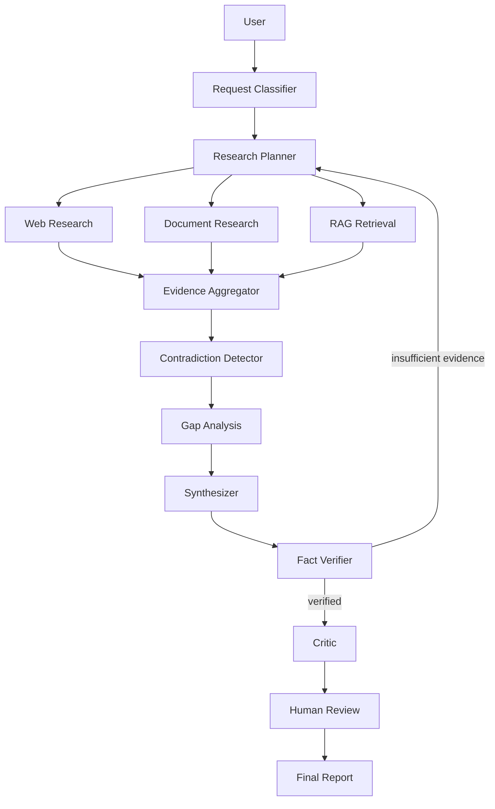

# Atlas

Atlas is a research assistant for analysts and decision makers: it breaks a business question into research tasks, gathers evidence from web sources and uploaded documents, flags contradictions, checks citations and pauses for a human to approve before it finalises a cited report.

Engineering notes on what can go wrong, what broke and how it was fixed are in [FAILURES.md](./FAILURES.md).

## What it does

Given a question such as:

> Analyse whether a small UK technology company should pursue a specific public-sector opportunity.

Atlas does not send that sentence straight to a model. It:

- classifies the request (intent, sensitivity, impact)
- plans structured research tasks and runs them in parallel
- searches public sources and an uploaded private corpus (hybrid vector and keyword retrieval over pgvector)
- turns what it finds into evidence objects, each tied to a URL or document id
- scores source quality, so a government source outranks an anonymous forum post
- detects contradictions between sources
- drafts a report, verifies citations and numbers, and has a critic review it
- pauses for human review when confidence is low, impact is high or contradictions remain

Any claim it cannot tie to evidence is marked unsupported rather than given an invented source.

## What is real in demo mode

Demo mode is the default (`MODEL_PROVIDER=demo`, `EMBEDDING_PROVIDER=demo`) and needs no API keys. In demo mode:

- the language model is a deterministic stand-in, so report wording is canned
- `web_search` returns entries from a curated built-in catalogue, not live results. Some catalogue URLs are illustrative (for example `news.example.com`)
- embeddings are deterministic hash projections, fine for tests but not for real retrieval quality
- the three files in `demo/documents/` are illustrative documents, not real company data

So a demo run shows the workflow, state handling and persistence working. It does not show research quality. Real providers (`openai`, `anthropic`, `google`, `ollama`) plug in through `MODEL_PROVIDER` but were not tested for this README.

## How it works



The workflow is a LangGraph state machine in `src/atlas/graph/workflow.py`. State is a typed `ResearchState` (plan, evidence, contradictions, confidence, iteration, human decision). Independent tasks fan out with LangGraph `Send`. Domain data (sessions, tasks, evidence, contradictions, reports) is stored in PostgreSQL; graph checkpoints are in memory, so a paused run cannot be resumed after the API process restarts.

### Agents

| Stage | Responsibility | Tools |
| --- | --- | --- |
| Classifier | Intent, sensitivity, impact | none |
| Planner | Structured `ResearchTask`s and queries | none |
| Researcher | Public sources | `web_search`, `fetch_web_page`, `calculator` |
| Document analyst | Private corpus | `search_documents`, `retrieve_document_chunks` |
| Contradiction detector | Structured conflicts | none |
| Synthesiser | Grounded report | none |
| Verifier | Citation and numeric checks; can loop | none |
| Critic | Attacks reasoning, does not rewrite | none |
| Human review | Approve / more research / cancel | none |

Agents do **not** share one mega-prompt. Tool access is least privilege.

Retrieval pipeline:

```text
Document -> parser -> metadata -> chunker -> embedding -> pgvector
Query -> rewrite -> vector search + keyword search -> RRF -> rerank -> dedup -> Evidence
```

Ingest formats: PDF, TXT, Markdown, DOCX, HTML. Source quality classes: `PRIMARY`, `GOVERNMENT`, `ACADEMIC`, `COMPANY_SOURCE`, `ESTABLISHED_MEDIA`, `INDUSTRY`, `COMMUNITY`, `UNKNOWN`. Full design notes are in [docs/ARCHITECTURE.md](docs/ARCHITECTURE.md).

## Quick start

Requires Python 3.12, [uv](https://docs.astral.sh/uv/) and Docker (for PostgreSQL with pgvector and Redis).

```bash
uv sync --extra dev
cp .env.example .env

docker compose up -d postgres redis
uv run alembic upgrade head
uv run python scripts/demo_ingest.py      # loads demo/documents into pgvector

uv run atlas-api                           # API on http://localhost:8000
```

In a second terminal:

```bash
curl -s -X POST localhost:8000/research -H 'content-type: application/json' \
  -d '{"query":"Analyse whether Acme Technology should enter the UK public-sector cybersecurity market. Identify market opportunity, barriers, procurement requirements, major competitors, risks and a recommended entry strategy."}'

# the run pauses for review; approve it with the research_id from the response
curl -s -X POST localhost:8000/research/<research_id>/resume \
  -H 'content-type: application/json' -d '{"decision":"approve"}'

curl -s localhost:8000/research/<research_id>/report
```

Optional Streamlit UI (talks to the API at `ATLAS_API_URL`, default `http://localhost:8000`):

```bash
uv run streamlit run src/atlas/apps/ui/app.py   # http://localhost:8501
```

`docker compose up --build` should start the API, UI, Postgres and Redis together, but the full Compose stack was not verified for this README.

### Real output

Demo mode, 1 November 2026. The first call returned `status: awaiting_human` with this progress log:

```text
Planning research...
Intent classified as opportunity_assessment.
5 research tasks created.
Completed task: What is the size and growth of the UK public-sector cybersecurity market?
Completed task: What procurement and accreditation barriers apply?
Completed task: Who are the major incumbents and how do they compete?
Completed task: What capabilities and commercial constraints does Acme have?
Completed task: What are the principal delivery, compliance and commercial risks?
60 evidence items collected.
2 contradictions identified.
Draft report produced.
Fact and citation verification complete.
Critic review complete.
Awaiting human review.
```

It paused with confidence 0.64 and two contradictions on Acme's annual revenue (£15m in filed accounts against £21m in a forum thread). After `approve` the status was `completed`, and the report began:

```text
## Executive Summary
Acme should pursue the market as a specialist subcontractor on established
frameworks rather than as a first-time prime bidder.

## Recommendation
Enter via G-Cloud / framework supply with Cyber Essentials Plus as a gate,
while resolving the revenue contradiction before material bids.
```

The wording comes from the demo model and the evidence from the built-in catalogue, so treat this as a check that the pipeline runs, not as research.

## Tests and evaluation

```bash
uv run pytest
uv run ruff check src tests apps
uv run mypy src
uv run atlas-eval
```

Results on 1 November 2026:

| Check | Result |
| --- | --- |
| `pytest` | 30 passed |
| `ruff check src tests apps` | all checks passed |
| `mypy src` | no issues in 101 source files |
| `atlas-eval` | 3 cases, mean score 0.93 |
| API run above (Postgres, Redis, demo mode) | start, pause, resume and report all worked after the fix below |
| Streamlit UI | starts and serves on :8501; not clicked through |
| GitHub Actions | passing |

`atlas-eval` gives every case the same scores (overall 0.933, groundedness 0.667, citations 1.0, coverage 1.0, contradiction found, 1 hallucination flag). That is a deterministic check of the scoring code against the demo model, not a measure of research quality on real questions, which has not been measured yet.

Tests cover chunking, citations, source scoring, routing, confidence, contradictions, tools and security. Graph tests run the compiled LangGraph app with the demo model. The tests do not exercise the Postgres repositories, which is how the bug below got through.

## API

| Method | Path | Purpose |
| --- | --- | --- |
| POST | `/research` | Start a run |
| GET | `/research/{id}` | Snapshot |
| POST | `/research/{id}/resume` | Human decision |
| POST | `/research/{id}/cancel` | Cancel |
| GET | `/research/{id}/evidence` | Evidence list |
| GET | `/research/{id}/contradictions` | Contradictions |
| GET | `/research/{id}/report` | Final report |
| GET | `/research/{id}/events` | SSE progress |
| POST/GET/DELETE | `/documents` | Ingest corpus |
| POST | `/feedback` | Human feedback |
| GET/POST/DELETE | `/memory` | Explicit long-term memory |
| GET | `/health` `/ready` | Probes |

Interactive docs at `http://localhost:8000/docs`. More detail in [docs/API.md](docs/API.md).

## Configuration

Copy `.env.example` to `.env`. Main groups:

| Setting | Purpose |
| --- | --- |
| `DATABASE_URL`, `DATABASE_URL_SYNC`, `REDIS_URL` | Postgres (async and sync) and Redis |
| `MODEL_PROVIDER`, `MODEL_NAME` | `demo` (default), `openai`, `anthropic`, `google` or `ollama` |
| `EMBEDDING_PROVIDER`, `EMBEDDING_MODEL`, `EMBEDDING_DIMENSIONS` | Embeddings, `demo` by default |
| Provider API keys | Only needed for real providers. Never commit them |
| `LANGSMITH_TRACING`, `LANGSMITH_API_KEY`, `LANGSMITH_PROJECT` | Optional tracing, off unless enabled with a key |
| `ATLAS_MAX_RESEARCH_TASKS`, `ATLAS_MAX_ITERATIONS`, `ATLAS_MAX_SOURCES`, `ATLAS_MAX_TOKENS`, `ATLAS_RESEARCH_BUDGET_USD` | Budgets per run |
| `ATLAS_HITL_LOW_CONFIDENCE` | Confidence below which a run pauses for review |

Security measures (prompt injection isolation, tool allow-lists, SSRF rules, upload limits, HTML sanitisation, secret redaction) are described in [docs/SECURITY.md](docs/SECURITY.md).

## Project structure

```text
atlas/
├── src/atlas/
│   ├── graph/          LangGraph workflow and nodes
│   ├── agents/         planner, researcher, verifier, critic and friends
│   ├── rag/            ingestion, chunking, hybrid retrieval
│   ├── tools/          web_search, fetch_web_page, calculator, document search
│   ├── services/       orchestrator, contradictions, confidence
│   ├── repositories/   Postgres access
│   ├── persistence/    SQLAlchemy models and sessions
│   ├── llm/            provider adapters including the demo model
│   ├── evaluation/     deterministic evaluation metrics
│   ├── security/       SSRF, sanitisation, redaction
│   ├── apps/           FastAPI app, worker and Streamlit UI
│   └── cli/            atlas-ingest and atlas-eval
├── alembic/            database migrations
├── demo/               sample documents and query
├── scripts/            demo_ingest.py
├── tests/
├── docker/, docker-compose.yml
└── docs/               API, architecture, security, known issues, build progress, ADRs
```

## Limitations and known issues

- Demo mode results say nothing about research quality (see above). No real provider run has been measured.
- Graph checkpoints are in memory. A run paused for review is lost if the API restarts, and multiple API replicas would not share state. `langgraph-checkpoint-postgres` is a dependency but not wired in by default.
- The default web search is a curated catalogue, and `fetch_web_page` does not do open internet access in demo mode.
- No PDF export. The Streamlit UI is a thin client.
- Fixed while preparing this README: `POST /research` returned 500 against Postgres because the session row was saved with a different id from the run, and resuming returned 500 because evidence was saved twice. Both are fixed in one commit; neither was caught by the tests.

More in [docs/KNOWN_ISSUES.md](docs/KNOWN_ISSUES.md) and [docs/BUILD_PROGRESS.md](docs/BUILD_PROGRESS.md).

## Architecture decisions

- [001 LangGraph](docs/adr/001-langgraph-for-orchestration.md)
- [002 Postgres + pgvector](docs/adr/002-postgres-pgvector.md)
- [003 Evidence-first RAG](docs/adr/003-evidence-first-rag.md)
- [004 Human-in-the-loop](docs/adr/004-human-in-the-loop.md)
- [005 Provider-independent LLMs](docs/adr/005-provider-independent-llms.md)
- [006 Hybrid retrieval](docs/adr/006-hybrid-retrieval.md)
- [007 Confidence scoring](docs/adr/007-confidence-scoring.md)

## Status

A working portfolio project in demo mode, run locally against Postgres and Redis. Not deployed, no users, and not tested with a real model provider yet. Contributions: see [CONTRIBUTING.md](CONTRIBUTING.md). More of my work is at [cv.omnitest.dev](https://cv.omnitest.dev/).

## Licence

[MIT](LICENSE). The copyright line currently reads "Atlas" rather than a person's name.
